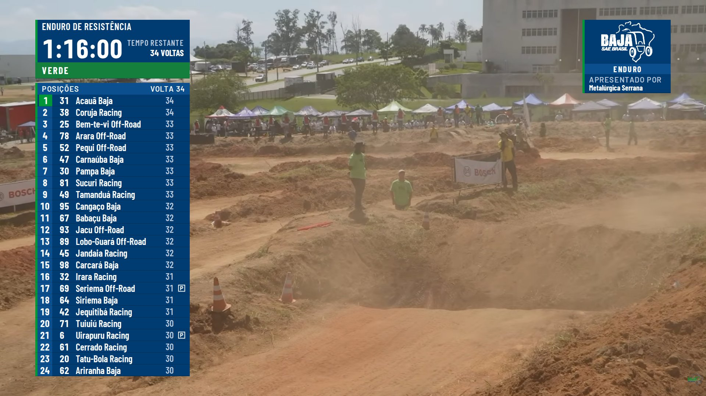
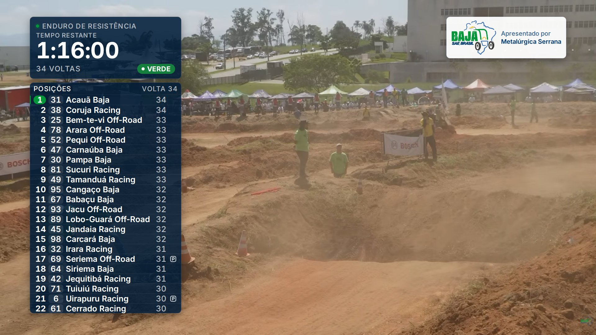
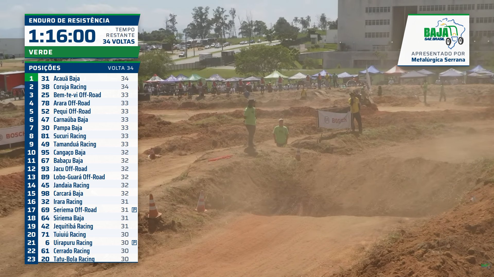
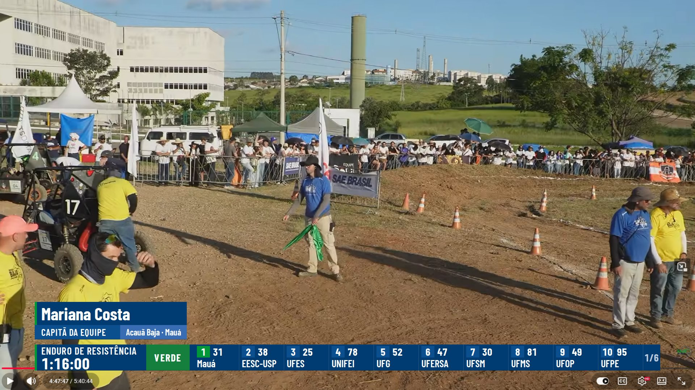
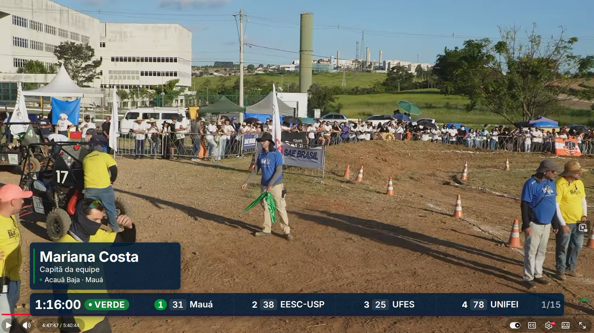
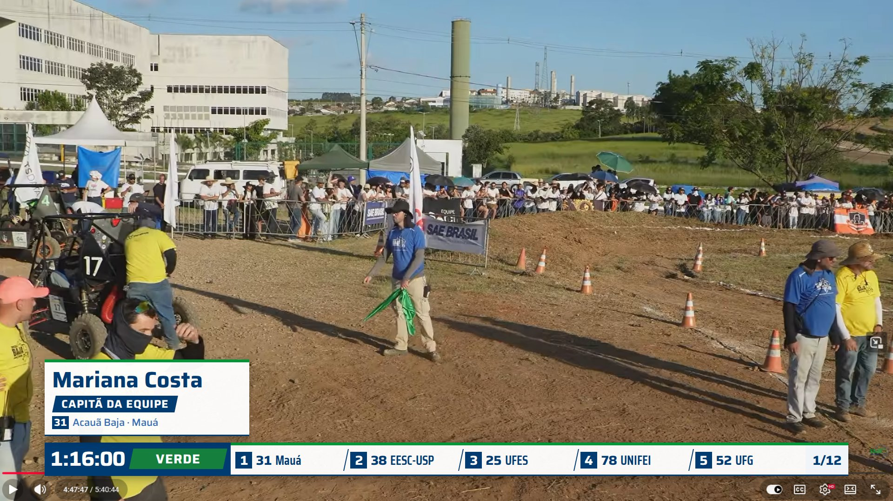

# Three directions for the on-air look (BAJAOVRLAY-22, pass 1)

Three genuinely different systems for the same six graphics, each over the same footage and
the same sample race (lap 34 of the enduro, 60 cars, car 31 "Acauã Baja" leading), so the
choice is about the look and not about the data. After João chooses, pass 2 extends that
direction to the rest of the §9 catalogue. Each folder holds the mock-up pages, `tokens.css`,
`styles.css`, `motion.md`, a `README.md` with the rationale, and `screenshots/`. The page
contract and the shared constraints are in [`../README.md`](../README.md).

The usual on-air set (race clock, compact tower, sponsor bug) over frame 1, left to right
placar, vidro, faixa:

| placar | vidro | faixa |
| --- | --- | --- |
|  |  |  |
|  |  |  |

## The comparison

| | **placar** — the timing board | **vidro** — smoked glass | **faixa** — the stripe |
| --- | --- | --- | --- |
| The idea | Opaque navy plates with hard corners and a 6px green spine: a scoreboard, information first. | Flat navy-tinted glass (86%) with 12px corners and hairlines; brand colours only as small lights. | White plates, navy type, a 12° angled ribbon on every plate; the clock's ribbon is the flag. |
| Material on air | Opaque `#003B71`, no shadow, no transparency. | `rgb(0 28 56 / 0.86)` tint, no blur (OBS cannot blur the video behind a browser source). | `rgba(255,255,255,.96)`, box-shadow and a 3px navy rule for separation from bright sky. |
| Type | Barlow Condensed (numbers, names) + Barlow (captions) | Inter | Saira (numbers, titles) + Saira Condensed (team names only) |
| Compact tower | **24 rows**, 32px, 420px wide | **22 rows**, 32px, 488px wide | **23 rows**, 32px, 440px wide |
| Detailed tower | 20 rows × 38px, 1016px wide | 18 rows × 40px, 1240px wide | 20 rows × 36px, 1140px wide |
| Lower strip | Pages of **10** cars (two-line cells), 6 pages, 7 s each, 150ms wipe | Pages of **4** cars, 15 pages, 6 s each, 300ms crossfade | Pages of **5** cars (equal cells), 12 pages, 7 s each, 400ms angled wipe |
| Race clock | 420 × 160, 72px time, full-width flag band | 488 × 200, 72px time, flag pill | 440 × 173, 72px time, skewed flag band |
| Sponsor bug | 240 × 200, white logo on navy, ENDURO cell | 386 × 134, colour logo on a light capsule | 280 × 204, colour logo on white with the angled cut |
| Leader cue | Green position cell | Green position pill + 3px green edge | Green position cell |
| Motion | Wipes from the left (260ms in, 200ms out), rows stagger 18ms; swaps 400ms | Fade + rise (320ms in, 200ms out), rows stagger 14ms; swaps 450ms with a glow | Angled wipes (300ms in, 220ms out), rows deal in 15ms; swaps 380ms |
| Footprint on the picture | Smallest column (420), opaque | Widest column (488), 14% see-through | 440, opaque white |
| OBS cost | Lowest: no filter, no shadow, no transform | Low now that the blur is gone; one entrance blur filter per row (removable) | Low: box-shadow, skew transforms on ribbons; a drop-shadow on the bug only |
| Brand presence with the bug off screen | Navy and green, logo printed white | Weakest: navy tint, green only in small cues | Strongest: white, navy, green stripe, colour logo |
| Reads as | A timing board; the least "2026" of the three | The calmest and most modern surface; closest to a dark-mode app | A current sports package; the 12° cap is the F1/MotoGP vocabulary, used with restraint |
| Rationale | [placar/README.md](placar/README.md) | [vidro/README.md](vidro/README.md) | [faixa/README.md](faixa/README.md) |

All three share: the flag palette (pre `#5B6472`, green `#15803D`, yellow `#FFD600` with a dark
word, red `#DC2626`, checkered, finished `#1F2937`), the status icons (P in a square, triangle,
circle with a slash, in a fixed column, retired rows dimmed), tabular figures on every number,
no brand yellow anywhere on air, everything inside the 90% title-safe area, and the school
name as the strip's short team name. Legibility floor on every direction: 26px names and
numbers in the compact tower, 28px in the strip, nothing under 20px.

## What a review panel said about the first draft

Three independent reviews scored the first draft (before the polish round) on one lens each.
The polish round then resolved the biggest findings: placar's clock and tower were made one
420px column, vidro was redrawn without the blur (which could never render in OBS) on a navy
tint with a leader pill, faixa's flag green got a white word that passes AA, and the flag
palette was unified. The rankings are still the best summary of the trade-offs:

| Lens | Ranking | The one-line reason |
| --- | --- | --- |
| Legibility on a phone at 720p | placar > faixa > vidro | Opaque plates keep the same backdrop whatever the footage; placar's flag band is the biggest state cue; vidro's tint changes with the picture and its tower covers the most. |
| Brand fit, "modern and clean" | faixa > placar > vidro | faixa wears the logo's palette on every plate; placar prints the logo white and reads 2015; vidro carries the brand mostly inside the bug. |
| The design as a system (tokens, extension, OBS risk) | placar > faixa > vidro | placar's tokens and motion are the tidiest and cheapest; faixa's skew is systemic but needs care; vidro's material had to change after the review. |

## Designer's note

Any of the three can be built. If the usual shot (clock, tower, bug over the dirt) must say
Baja SAE Brasil on its own, choose **faixa**. If maximum density, the surest legibility on a
phone and the lowest cost in OBS matter more, choose **placar**. Choose **vidro** for the
calmest, most modern surface, accepting the weakest brand presence and the widest column.

Each direction's README ends with "Open questions for João": widths, the strip's density and
the detailed tower's columns are the ones that change pass 2 most.

## Looking at them

```
node docs/design/tools/screenshot.mjs --all      re-shoot every page over every background
node docs/design/tools/checkLayout.mjs placar    title-safe boxes, rows and smallest text
open docs/design/directions/placar/motion-demo.html   the in/out, swap and strip motion
```

Every page opens from the file system (`docs/design/directions/<direction>/<page>.html`) with
frame 1 behind it; the screenshot tool swaps the background for the other frames, grey and black.
