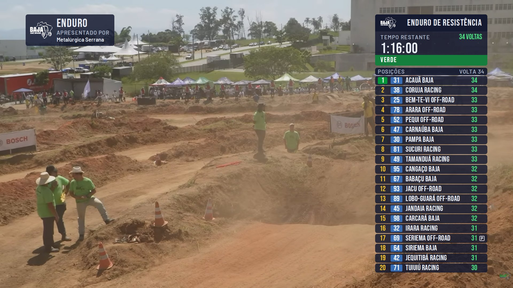
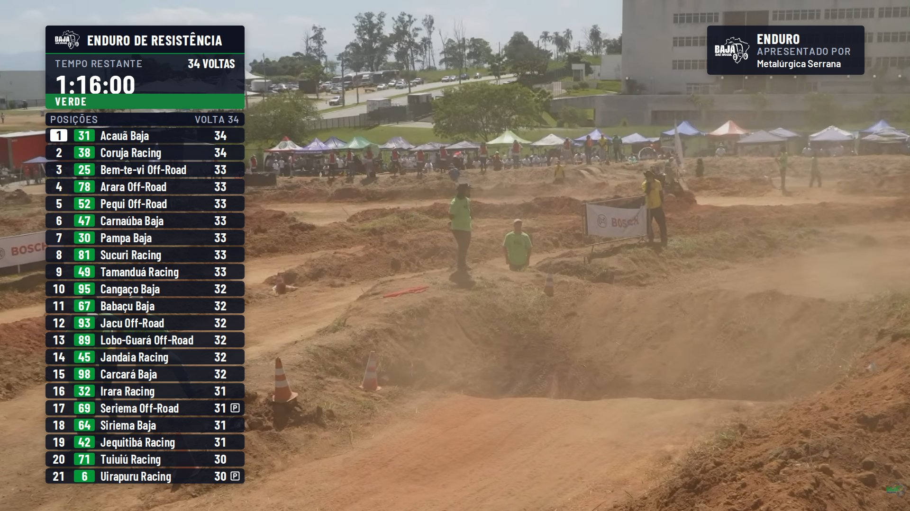
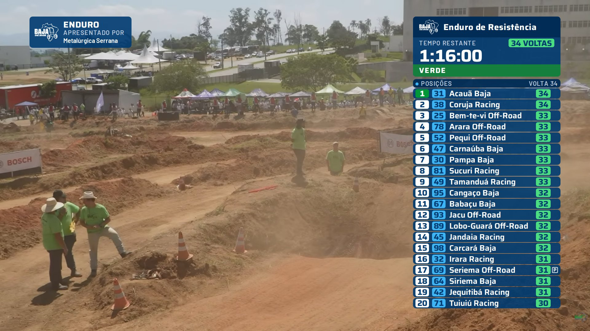
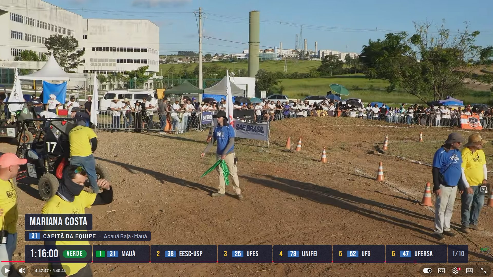
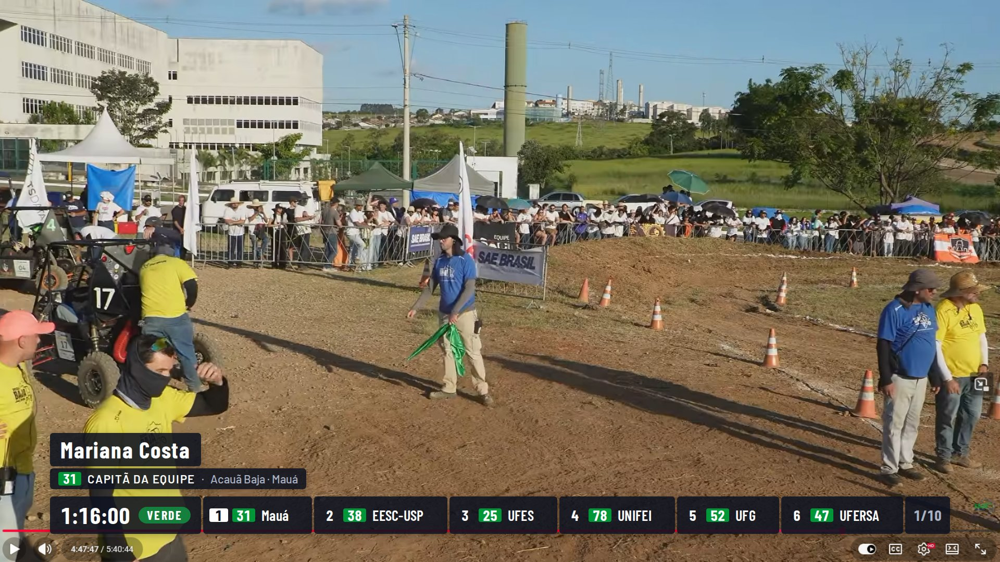
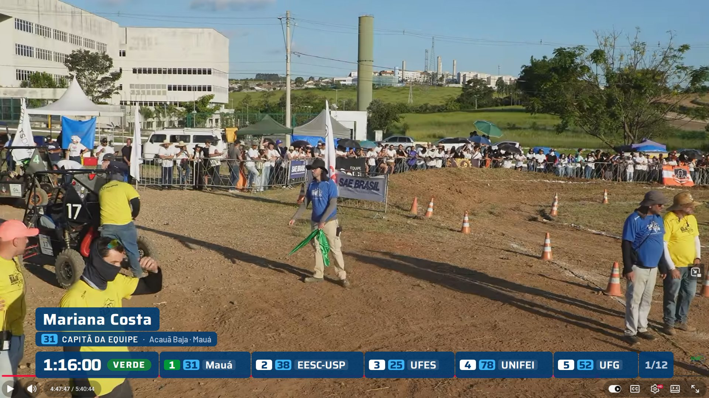

# Three directions for the on-air look (BAJAOVRLAY-22, pass 1)

Three siblings of the scoreboard the stream uses today (placarbaja.juansalles.com.br: a slate
column of pill rows, a car-number chip, a colour per column, Urzeit), each keeping that style
and growing it into the full set of six graphics over the same footage and the same sample
race (lap 34 of the enduro, 60 cars, car 31 "Acauã Baja" leading). After João chooses, pass 2
extends that direction to the rest of the §9 catalogue. The three share one markup
(`../tools/slateTemplates.mjs`) and one structure sheet (`../tools/slate-base.css`); a
direction is its `tokens.css`, a short `styles.css`, its row counts, its `motion.md` and its
`README.md`. The page contract is in [`../README.md`](../README.md).

The usual on-air set (race clock, compact tower, sponsor bug) over frame 1 and the strip with
a lower third over frame 3, left to right ardosia, grafite, marinho:

| ardosia | grafite | marinho |
| --- | --- | --- |
|  |  |  |
|  |  |  |

## The comparison

| | **ardosia** — the scoreboard, kept | **grafite** — one colour, one accent | **marinho** — navy, every cell a chip |
| --- | --- | --- | --- |
| The idea | Today's look grown into a system: slate pills, yellow positions, blue car chip, green laps, caps type. | The same structure with the colour taken out: graphite pills, white type, brand green on the car chip only. | The same structure on brand navy with three chips per row (white position, sky-blue car, green laps). |
| Surface | `rgb(20 25 48 / 0.84)`, 8 px corners, 3 px gaps, no shadow | `rgb(14 18 32 / 0.88)`, 6 px corners, 4 px gaps, soft shadow | `rgb(0 59 113 / 0.90)`, 10 px corners, 2 px gaps, no shadow |
| Type | Bebas Neue (caps, as the scoreboard) + Barlow | Barlow Condensed + Barlow | Saira + Barlow |
| Colour on air | Yellow text, blue chip, green text, green leader chip | White, green chip, white leader chip | Navy, white/sky/green chips, green leader chip |
| Brand yellow | As position text only, never a field (the scoreboard's yellow) | None | None |
| Column | 420 px, right (as the scoreboard) | 420 px, left (broadcast convention) | 480 px, right (Saira is wide) |
| Compact tower | **20 rows** of 34 px | **21 rows** of 32 px | **20 rows** of 34 px |
| Detailed tower | 19 rows, 1060 px | 19 rows, 1060 px | 19 rows, 1120 px |
| Lower strip | **6** cars/page, 10 pages, 7 s | **6** cars/page, 10 pages, 7 s | **5** cars/page, 12 pages, 6 s |
| Race clock | 420 × 192, logo + session in caps, 56 px time, 40 px flag band | 420 × 176, green rule under the head, 32 px flag band | 480 × 196, mixed-case session, laps on a green chip |
| Sponsor bug | 332 × 118, top-left | 332 × 104, top-right | 332 × 102, top-left |
| Motion | Rise 20 px + fade, 400/250 ms, rows 30 ms apart | Rise 16 px + fade, 280/180 ms, rows 16 ms apart | Pop (rise 12 px, scale .92→1), 360/220 ms, rows 24 ms apart |
| Closest to today | Yes: a viewer of the current stream recognises it at once | The structure, not the colours | The structure and the sky-blue chip |
| Weakest contrast pair | Leader chip 3.83:1 (large text) | Car chip 3.83:1 (large text) | Leader chip 3.83:1 (large text) |
| Rationale | [ardosia/README.md](ardosia/README.md) | [grafite/README.md](grafite/README.md) | [marinho/README.md](marinho/README.md) |

All three share: the flag palette (pre `#5B6472`, green `#15803D`, yellow `#FFD600` with a dark
word, red `#DC2626`, checkered, finished `#1F2937`) in a full-width band under the clock and a
pill in the strip; the status icons (P in a square, triangle, circle with a slash, in a fixed
column, retired rows dimmed); tabular figures on every number; everything inside the 90%
title-safe area; the school name as the strip's short team name; paging, never scrolling, in
the strip; and the legibility floor (26 px names and numbers in the tower, 28 px in the strip,
nothing under 20 px). Every page is static HTML written by the direction's `generatePages.mjs`.

## What the scoreboard had that these fix

- Urzeit is a "Personal Use" licence and cannot ship; Bebas Neue (ardosia) is the closest
  clean caps face with tabular figures (`../fonts/README.md` lists the ones that failed).
- The 30 px margin put the panel outside the 90% title-safe area; every graphic is inside now.
- No race clock on air, no flag state, no status icons, no gaps or lap times: all six graphics
  exist in each direction, as one family.
- Rows entered 300 ms apart (5.4 s to fill a page of 18); here 16–30 ms apart.
- Yellow position numbers next to no flag indicator; here the flag always shows its word in
  its own band, and two directions have no yellow at all.

## Designer's note

**ardosia** if the point is continuity: it is today's scoreboard, corrected, and the audience
already reads it. **grafite** if "modern and clean" weighs more than continuity: same bones,
calmer, no yellow. **marinho** if the brand navy should be the surface and the chips the
signature; it costs 60 px of width. Each README ends with "Open questions for João"; the
strip's density (one-line pills hold 5–6 cars, two-line cells would hold 10) and the column's
side are the ones that change pass 2 most.

## Looking at them

```
node docs/design/tools/screenshot.mjs --all        re-shoot every page over every background
node docs/design/tools/checkLayout.mjs ardosia     title-safe boxes, rows and smallest text
open docs/design/directions/ardosia/motion-demo.html   the in/out, swap and strip motion
```

Every page opens from the file system (`docs/design/directions/<direction>/<page>.html`) with
frame 1 behind it; the screenshot tool swaps the background for the other frames, grey and black.
