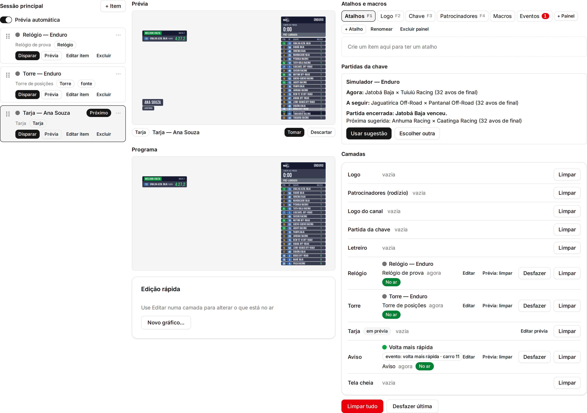
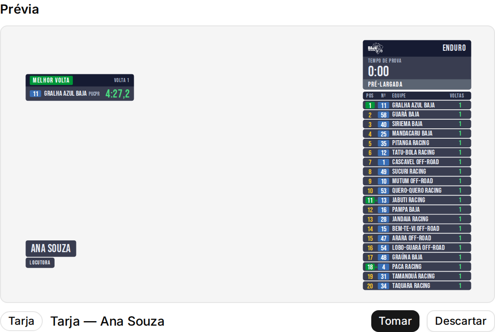
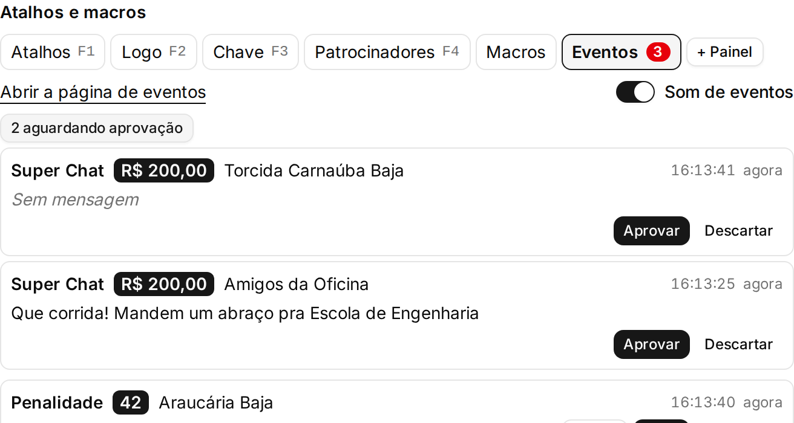
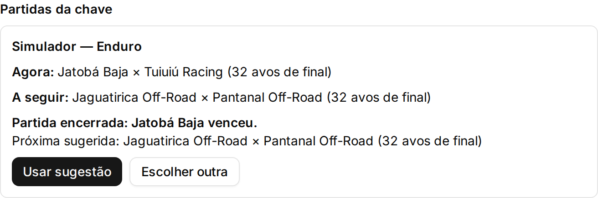

# Guia do operador — BajaOvrLay

Uma folha para quem opera os gráficos da transmissão. Duas pessoas, duas mesas: o **Produtor** comanda o que vai ao ar; **Dados** prepara e modera. Tudo o que você faz fica no servidor: fechar ou recarregar a página não perde nada e não tira nada do ar.

## 1. Antes de entrar no ar

- Abra o endereço do console no navegador (o João passa no dia). Em "Entrar", escolha o "Papel" ("Produtor" ou "Dados"), digite o "PIN" e o nome da sua mesa em "Estação" (por exemplo Mesa 1).
- Confira o cabeçalho, da esquerda para a direita:

- O selo "Fontes" verde: os dados da prova chegam. Amarelo ou vermelho: veja a seção 8.
- "OBS" com "Conectado" (ou "não configurado", como na foto, quando o João não liga o controle do OBS). Se disser "Sem conexão", avise o João; os gráficos continuam saindo.
- "Conectado" em preto: a página fala com o servidor. Seu papel e mesa aparecem ao lado, com "Sair".
- Abra o "Menu" (☰) e clique em "Verificar servidor": deve dizer que o servidor está no ar e "Fontes ligadas: todas ok."
- Nenhum aviso vermelho de relógio no cabeçalho.

## 2. O console num relance

- **Esquerda — "Rundown":** a lista de itens preparados, em ordem. A linha marcada "Próximo" é a que a barra de espaço põe no ar. Clique no nome de um item para marcá-lo. Cada linha tem "Disparar" (direto ao ar) e "Prévia".
- **Centro — "Prévia" em cima, "Programa" embaixo:** a Prévia mostra como a tela vai ficar; o Programa é o que está no ar agora.
- **Direita — "Atalhos e macros":** abas de botões prontos. **F1** a **F4** abrem as abas; as teclas **1** a **9** disparam o 1º ao 9º botão da aba aberta. A aba "Eventos" fica aqui também.
- **Direita, embaixo — "Camadas":** uma linha por camada da tela, com o que está nela ("vazia" ou o nome do item e "No ar"), "Limpar" e "Desfazer".
- O botão **?** no canto lista todos os atalhos de teclado.

## 3. Pôr no ar e tirar do ar

- **Com prévia (o jeito seguro):** "Prévia" no item, confira o monitor, depois "Tomar" na linha embaixo da Prévia. Com várias camadas em prévia, "Tomar tudo" leva todas juntas; "Descartar" joga a prévia fora sem tocar no ar.

- **Barra de espaço:** põe no ar o item "Próximo" (ou a prévia dele, se ela estiver aberta) e passa para o seguinte. As setas **←** **→** só movem o cursor.
- **Gráfico em passos** (pódio, chaveamento): "Próximo" na linha da camada mostra o passo seguinte.
- **Tirar uma camada:** "Limpar" na linha dela, em "Camadas".
- **Tirar tudo:** "Limpar tudo" (ou **Esc**) arma o botão; aperte de novo em até 3 segundos para confirmar.
- **Errou?** **Ctrl+Z** ou "Desfazer última" devolve o que estava no ar antes da última troca. "Desfazer" numa linha de Camadas faz o mesmo só naquela camada.

## 4. Eventos (penalidades, avisos, voltas mais rápidas)

- O número vermelho na aba "Eventos" conta o que espera. Cada evento tem "Prévia", "No ar" e "Descartar". Descartou sem querer? "Desfazer" aparece por 30 segundos.
- O que não esperou ao vivo ou já passou fica na página de eventos ("Abrir a página de eventos"): no histórico, "Mostrar de novo" traz um evento exibido de volta para a aba, e "Restaurar" traz um descartado.
- **Aviso digitado** (Produtor): na página de eventos, "+ Evento". Escolha a equipe pelo número ou nome, ou "Sem equipe (aviso geral)" para um recado a todos; escreva o "Motivo" e clique em "Criar evento". Ele entra na aba "Eventos" como os outros.

## 5. Super Chats

- Dados lê e modera: na lista "Super Chats aguardando aprovação", "Aprovar" ou "Descartar". Nada de espectador vai ao ar sem aprovação.
- O Produtor vê na aba "Eventos" quantos aguardam e os aprovados prontos: "No ar" põe o Super Chat na tela pelo tempo da regra.

## 6. Super Prime ("Partidas da chave")

- O painel mostra a partida "agora" e a "a seguir". Os gráficos da aba **Chave** (**F3**) sempre mostram essas duas.
- Quando uma partida termina, o painel diz quem venceu e sugere a próxima: "Usar sugestão" aceita. Para outra ordem (por exemplo a final logo depois da disputa de 3º lugar), "Escolher partida" e então "Agora" ou "A seguir" na partida certa.

## 7. Gatilhos

- O rodízio de patrocinadores ("Patrocinadores a cada 30 min", ligado pelo João em "Gatilhos") pergunta antes de rodar: aparece na aba "Eventos" com "Rodar" e "Descartar".
- Em momentos que não podem ter nada novo na tela (pódio, entrevista), "Menu" → "Pausar gatilhos". O cabeçalho mostra "Gatilhos pausados" até você clicar em "Retomar".

## 8. Quando algo dá errado

- **Fonte atrasada** (selo "Fontes" amarelo, linha de Camadas com "fonte atrasada"): o ar continua com o último dado bom; nada some da tela. Não limpe nada por causa disso. Avise o João; quando a fonte voltar, os dados seguem sozinhos.
- **Aviso de relógio** no cabeçalho (Relógio do servidor fora da hora certa): o servidor não se acerta sozinho porque há um relógio no ar. Num momento em que um pulo do relógio não atrapalhe (intervalo, ou com o relógio fora do ar), o Produtor abre "Menu" → "Acertar relógio agora" e confirma em "Acertar agora". O relógio de prova pula de uma vez.
- **Tomada recusada:** se a outra mesa tomou a mesma camada antes, a sua é recusada com uma mensagem. Olhe o Programa e Camadas antes de tentar de novo.
- **"Reconectando…"** no lugar de "Conectado": a página perdeu o servidor e volta sozinha. Os botões ficam cinza até voltar. O ar não depende da sua página.
- **Cópia de segurança:** no fim do dia (ou quando o João pedir), "Menu" → "Cópia de segurança" → "Baixar" e salve no pendrive.

## 9. Quem faz o quê

**Produtor**

- Põe no ar e tira do ar: Rundown, atalhos, Prévia/"Tomar", "Limpar", **Ctrl+Z**.
- Leva eventos e Super Chats aprovados ao ar ("No ar"), descarta eventos, digita avisos ("+ Evento").
- Escolhe as partidas do Super Prime; pausa gatilhos; acerta o relógio.

**Dados**

- Aprova ou descarta Super Chats.
- Vigia as fontes e o selo "Fontes"; avisa o Produtor e o João quando algo atrasa.
- Prepara itens, rundown e cadastros quando o João pedir.
- Não muda o que está no ar: os botões de ar ficam cinza para Dados.
